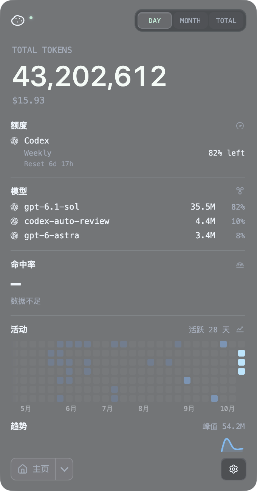
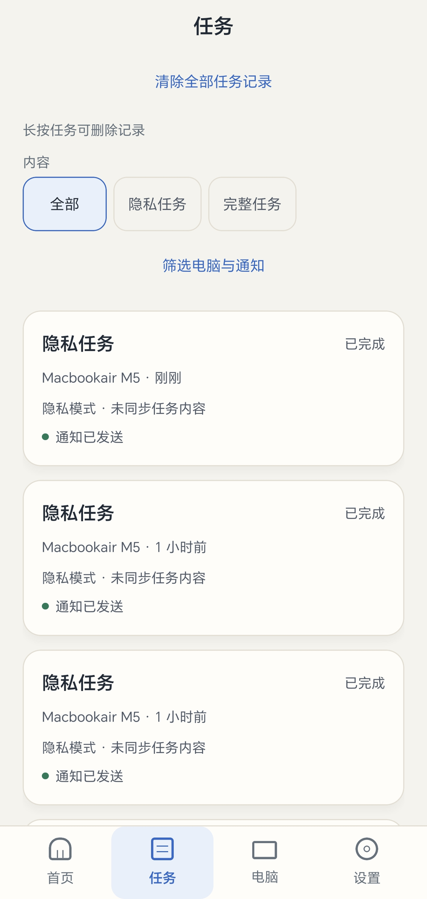
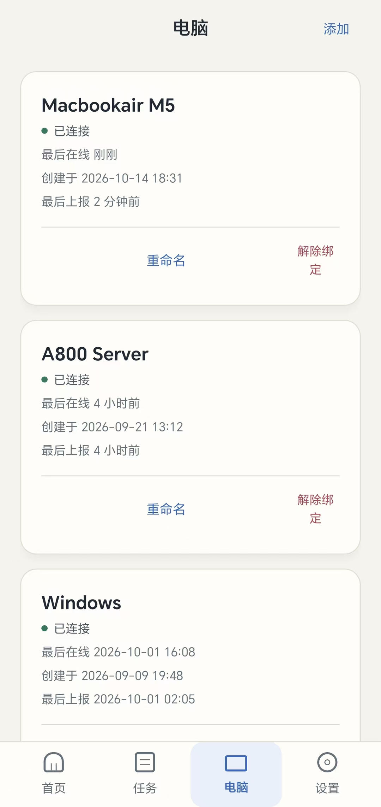
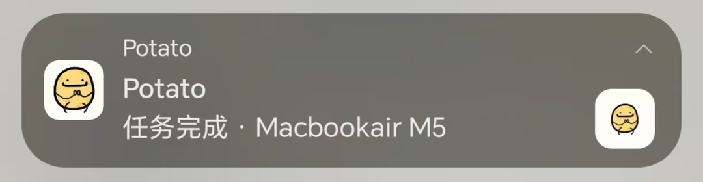
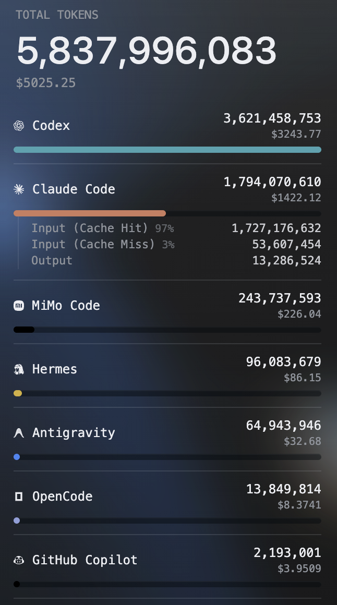
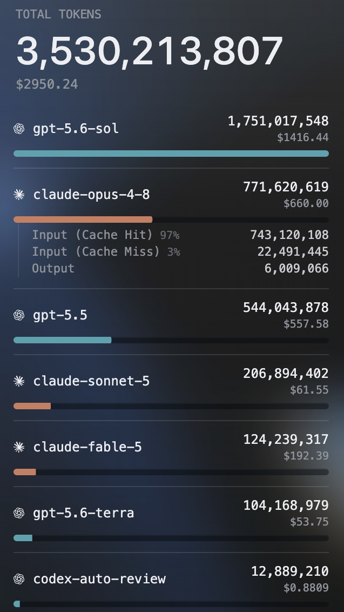
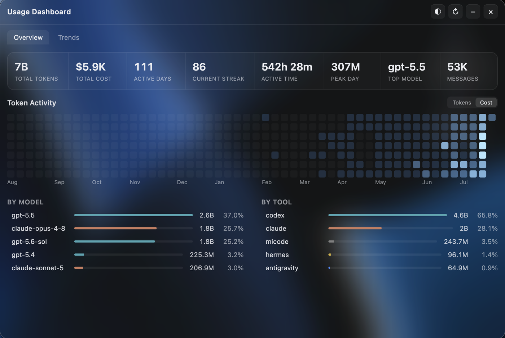
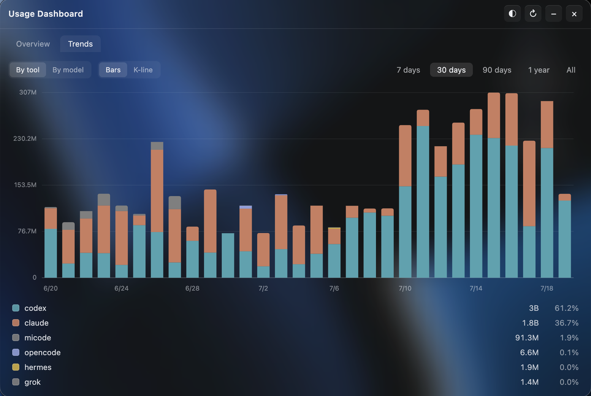

<p align="right"><strong>English</strong> | <a href="README.zh-CN.md">简体中文</a></p>

<p align="center"></p>
<h1 align="center">Potato</h1>
<p align="center">Your AI coding usage, limits, costs, and task completions, in one place.</p>
<p align="center"><a href="#download"><strong>Download</strong></a> · <a href="#features">Explore features</a> · <a href="#android-companion">Android companion</a></p>
<p align="center">
  <a href="https://github.com/Gary06910/Potato/releases"></a>
  <a href="LICENSE"></a>
</p>
<p align="center">Windows x64 · macOS Apple Silicon · Android · Linux Server Agent</p>

<a id="download"></a>
## Download

[Download the latest preview from GitHub Releases.](https://github.com/Gary06910/Potato/releases) Choose the file for your device:

| Platform | Download file | Best for |
| --- | --- | --- |
| **Windows x64** | [Installer](https://github.com/Gary06910/Potato/releases) · `Potato-Setup-1.0.0.exe` | Recommended for everyday desktop use |
| **Windows x64** | [Portable](https://github.com/Gary06910/Potato/releases) · `Potato-1.0.0.exe` | Run without installing |
| **macOS Apple Silicon** | [DMG](https://github.com/Gary06910/Potato/releases) · `Potato-1.0.0-arm64.dmg` | M-series Macs (arm64) |
| **Android** | [Mobile companion](https://github.com/Gary06910/Potato/releases) · `Potato-Android-0.1.1-code6.apk` | Task notifications and records on your phone |
| **Linux x64** | [Server Agent](https://github.com/Gary06910/Potato/releases) · `To-Know-Agent-1.0.0-linux-x64.tar.gz` | Headless collection on servers; a CLI, not a desktop GUI |

SHA256 checksums are included with releases. macOS downloads in this preview are for Apple Silicon only.

<p align="center"></p>
<p align="center"><sub>See today's usage, remaining quota, and recent activity at a glance.</sub></p>

## What Potato does

- **Keep usage in view.** Follow live token counts and estimated costs while you code.
- **Know your limits.** Check quota windows, remaining balances, and reset times across supported providers and accounts.
- **Understand your work.** Explore usage by tool, model, session, or project, with activity heatmaps and historical trends.
- **Step away from your desk.** Pair Android to receive Codex completion notifications and review task records.
- **Bring devices together.** Start locally, then add a sync hub when you want a shared view across machines.

## Get started in three steps

1. **Install Potato.** On Windows, run `Potato-Setup-1.0.0.exe`; the portable `Potato-1.0.0.exe` runs directly. On macOS, download `Potato-1.0.0-arm64.dmg`, open it, drag Potato to **Applications**, and launch Potato.
2. **Open the app.** Collection starts automatically for supported local AI-tool logs. Single-device use is local-first and works without a hub.
3. **Make it yours.** Add provider accounts under AI Tool Limits, [pair your Android phone](#android-companion), or enable [multi-device sync](#multi-device).

If macOS blocks the first launch, open **System Settings → Privacy & Security → Open Anyway**.

<a id="android-companion"></a>
## Stay in the loop away from your desk

Potato Desktop sends Codex task completions through your configured Potato service to the Android companion. Your phone receives a notification, and the task stays available in its task records. Pairing persists across Desktop restarts.

1. Install `Potato-Android-0.1.1-code6.apk` on your phone, open Potato, sign in, and allow notifications.
2. Open the Android pairing page to get a **six-digit code**. In Desktop **Settings → Phone notifications**, use the same Potato service address as your Android app, enter the code, and connect.
3. Enable **Codex completion notifications**. On first use, enter `/hooks` in Codex and trust the **Potato Stop Hook**. Keep Potato Desktop running to deliver completions.

Privacy mode is on by default and sends completion records without task text. Follow the in-app background-protection guide for your phone to keep notifications working when the app is in the background.

<table>
  <tr>
    <td width="50%" align="center" valign="top">
      <strong>Review completed tasks</strong><br><br>
      <br>
      <sub>Revisit completion records while task text stays private.</sub>
    </td>
    <td width="50%" align="center" valign="top">
      <strong>See your connected computers</strong><br><br>
      <br>
      <sub>Check connected computers and when they last reported.</sub>
    </td>
  </tr>
</table>

<p align="center"></p>
<p align="center"><sub>Get a task-completion notification while you're away from your desk.</sub></p>

<a id="features"></a>
## A closer look

<table>
  <tr>
    <td width="50%" align="center" valign="top">
      <strong>Where your tokens go</strong><br><br>
      <br>
      <sub>Compare tools and expand input, output, and cache usage.</sub>
    </td>
    <td width="50%" align="center" valign="top">
      <strong>What each model costs</strong><br><br>
      <br>
      <sub>See model usage and cost across your coding tools.</sub>
    </td>
  </tr>
  <tr>
    <td width="50%" align="center" valign="top">
      <strong>Your activity over time</strong><br><br>
      <br>
      <sub>Explore active days, streaks, and the tools behind them.</sub>
    </td>
    <td width="50%" align="center" valign="top">
      <strong>Spot changes in usage</strong><br><br>
      <br>
      <sub>Compare daily trends by tool or model over a chosen period.</sub>
    </td>
  </tr>
</table>

**A desktop companion that fits your workflow.** Keep usage in the macOS menu bar or Windows system tray, use a floating bubble, and adjust themes, colours, fonts, and window appearance. Track multiple provider accounts and switch a saved Codex account into active use.

<details>
<summary>More ways to explore and customize</summary>

- **Session and project views:** inspect supported local session details and group usage by project. Session details stay local.
- **Flexible periods:** today, month, total, this week, last 7 days, and last 30 days; costs can display in USD, TWD, HKD, or CNY.
- **History and export:** preserve observed daily usage after source sessions are deleted, and export CSV + JSON manually or automatically. See the [export guide](docs/export.md).
- **A dashboard you arrange:** show, hide, pin, and reorder tools and Home modules; customize menu bar and floating-bubble layouts and the show/hide shortcut.
- **Optional extras:** live token rate, service status, Codex reset forecasts from a third-party service, subscription records, and Discord Rich Presence.
- **WSL on Windows:** usage from running distros is detected automatically; SQLite-backed tools may need an [agent inside WSL](docs/wsl-sqlite-setup.md).

Settings include AI Tool Limits (provider selection, limits, and credentials). See the [configuration reference](docs/configuration.md) for collection, appearance, account, and sync options.

</details>

## Supported AI tools

Potato covers **37 tool and provider integrations**: **30** support token usage and **24** support AI Tool Limits, with overlap between the two. Claude Code, Codex, Cursor, GitHub Copilot, OpenCode, and many more are included. Usage, limits, and session detail support are listed separately below.

<details>
<summary>View the full supported-tools matrix</summary>

| Logo | Tool | Data path | Token Usage | AI Tool Limits | Session Details |
|:---:|------|-----------|:---:|:---:|:---:|
|  | Claude Code | `~/.claude/projects/`, `~/.claude/transcripts/` | ✅ | ✅ | ✅ |
|  | Codex | `~/.codex/` (`sessions/`, `archived_sessions/`) | ✅ | ✅ | ✅ |
|  | OpenCode | `~/.local/share/opencode/` (`opencode*.db`, `storage/message/`) | ✅ | ✅ | ✅ |
|  | Hermes Agent | `~/.hermes/state.db` | ✅ | — | — |
|  | OpenClaw | `~/.openclaw/agents/` | ✅ | — | — |
|  | Cursor IDE / Cursor CLI | `~/.config/tokscale/cursor-cache/` (account-level usage export) | ✅ | ✅ | — |
|  | Antigravity | `~/.gemini/` (`antigravity/`, `antigravity-ide/`, `antigravity-backup/`, `antigravity-cli/conversations/`) | ✅ | ✅ | — |
|  | Cline | VS Code globalStorage tasks (`.../saoudrizwan.claude-dev/tasks/`), `~/.cline/data/sessions/` | ✅ | — | — |
|  | Amp | `~/.local/share/amp/threads/` | ✅ | — | — |
|  | Factory Droid | `~/.factory/sessions/` | ✅ | ✅ | — |
|  | Kimi CLI / Kimi Code / Kimi Work | `~/.kimi/sessions/`, `~/.kimi-code/sessions/`, `<platform-app-data>/kimi-desktop/` | ✅ | ✅ | — |
|  | Qwen CLI | `~/.qwen/projects/` | ✅ | — | — |
|  | Grok Build | `~/.grok/` (`sessions/`, `logs/unified.jsonl`) | ✅ | ✅ | — |
|  | GitHub Copilot | VS Code `workspaceStorage/*/chatSessions/`, `~/.copilot/` (`otel/`, `data.db`) | ✅ | ✅ | — |
|  | Pi / Oh My Pi | `~/.pi/agent/sessions/`, `~/.omp/agent/sessions/` | ✅ | — | — |
|  | Zed | `~/.local/share/zed/threads/threads.db` | ✅ | ✅ | — |
|  | Kilo | `~/.local/share/kilo/kilo.db`; VS Code globalStorage tasks (`.../kilocode.kilo-code/tasks/`) — extension logs on Linux & remote/WSL only | ✅ | — | — |
|  | Command Code | `~/.commandcode/projects/**/*.jsonl` | ✅ | ✅ | — |
|  | MiMo Code | `~/.local/share/mimocode/mimocode.db` | ✅ | ✅ | — |
|  | ZCode / GLM | `~/.zcode/` (`projects/`, `cli/db/db.sqlite`) | ✅ | ✅ | — |
|  | Kiro | `~/.kiro/sessions/cli/`, Kiro IDE globalStorage & `kiro-cli` DB | ✅ | ✅ | — |
|  | CodeBuddy | `~/.codebuddy/projects/` + IDE / VS Code extension logs | ✅ | — | — |
|  | WorkBuddy | `~/.workbuddy/projects/`, `~/.workbuddy/workbuddy.db` | ✅ | ✅ | — |
|  | Proma | `~/.proma/agent-sessions/*.jsonl` | ✅ | — | — |
|  | Qoder | `<platform-app-data>/QoderCN/SharedClientCache/cache/db/local.db` (CN only) | ✅ | ✅ | — |
|  | Reasonix | `~/.reasonix/` (`stats/`, `sessions/`, `projects/*/sessions/`) | ✅ | — | — |
|  | DeepSeek / DeepSeek Harness | `~/.dsh/sessions/` (`session.jsonl`, `session.jsonl.zstd`) | ✅ | ✅ | ✅ |
|  | Cherry Studio | `<platform-app-data>/CherryStudio/` (`Data/Agents/.claude/projects/` V2, `.claude/projects/` legacy) | ✅ | — | — |
|  | LM Studio | `~/.lmstudio/server-logs/**/*.log` | ✅ | — | — |
|  | Unsloth Studio | `~/.unsloth/studio/studio.db` | ✅ | — | — |
|  | OpenRouter | OpenRouter API key (usage/key limit; balance when credits access is authorized, documented for Management keys) | — | ✅ | — |
|  | Minimax | Minimax API key (Token Plan quota via Minimax API) | — | ✅ | — |
|  | Volcengine | Ark API key or Volcengine AK/SK (Ark Coding Plan & Agent Plan quota via Volcengine API) | — | ✅ | — |
|  | Ollama | Ollama Cloud cookie (session/weekly usage via ollama.com/settings) | — | ✅ | — |
|  | Trae CN | Trae CN access token (Trae CN / SOLO credits via trae.cn) | — | ✅ | — |
|  | Alibaba Cloud | Alibaba Cloud console cookie (Bailian / Model Studio Token Plan quota, Team & Personal) | — | ✅ | — |
|  | Third-party APIs | New API / Sub2API-compatible account presets (including compatible One API forks), a New API API-key preset, and a Custom balance endpoint | — | ✅ | — |

</details>

<details>
<summary>Collection notes and custom data paths</summary>

- Paths in the matrix are defaults. Collection follows the supported tool's environment overrides, including `$XDG_DATA_HOME`, `$CODEX_HOME`, `$GROK_HOME`, `$HERMES_HOME`, `$KIMI_CODE_HOME`, `$UNSLOTH_STUDIO_HOME`, `$LM_STUDIO_HOME`, `$DSH_HOME`, `$REASONIX_STATE_HOME`, `$REASONIX_HOME`, and the `$CLINE_*` family. Extra scan folders can be added in Settings.
- LM Studio tracking covers `/v1/chat/completions` and `/v1/responses` recorded in server logs. Its built-in Chat UI and native `/api/v1/chat` requests are outside this collection path.
- Unsloth Studio tracks inference from Studio chats and its local API. Local inference has zero API cost; metered providers use price estimates. Training tokens are outside this scope. See the [Unsloth source notes](docs/providers/unsloth.md).
- Command Code token counts are estimated from transcript text. Model attribution and estimated cost use the available model configuration, which can differ from the model used historically.
- Cursor usage comes from its account-level export and includes IDE and CLI activity. Signed-in desktop accounts are detected automatically, and accounts can also be added in Settings. Finished sessions can take a few minutes to appear in the provider export.
- MiMo Code and Qoder CN collection are opt-in. MiMo's imported Claude Code sessions can overlap with Claude Code usage.
- Qoder CN reads its local SQLite database. Enable it under collection settings; the default database is `~/Library/Application Support/QoderCN/SharedClientCache/cache/db/local.db` on macOS, `%APPDATA%\QoderCN\SharedClientCache\cache\db\local.db` on Windows, and `~/.config/QoderCN/SharedClientCache/cache/db/local.db` on Linux. Override it with `TOKEN_MONITOR_QODER_CN_DB_PATH`. Reading requires the `sqlite3` CLI or Node with unflagged `node:sqlite` (23.4+); costs use model price estimates.
- Third-party integrations support New API / Sub2API-compatible account presets, a New API API-key preset, and Custom balance endpoints. Custom maps numeric JSON fields from a GET balance endpoint; a chat-completions endpoint alone does not supply balance data.

</details>

<a id="multi-device"></a>
## Across computers and servers

For a shared desktop view, open **Settings → Multi-device Sync** on an always-on computer and choose **Host hub on this device**. Connect other desktops with its hub URL and secret. The host must keep Potato running. You can also host the hub with Node or [Cloudflare Workers](worker/README.md); the Worker guide includes Widgy and Scriptable widgets for iPhone.

The **Linux x64 Server Agent** collects usage on headless servers and supports background operation. It is a command-line companion, not a Linux Desktop app. See the [Server Agent setup and service guide](docs/TO_KNOW_SERVER_AGENT_LINUX_SERVICE.md). For sync settings and integrations, see the [configuration reference](docs/configuration.md) and [hub API](docs/API.md).

<details>
<summary>Local data and retained history</summary>

Enable **Preserve deleted session usage** in Settings → Collection to retain observed daily tool/model usage locally. Heatmaps and sync use a rolling 370-day window; the local archive retains older observations. Collection starts with the data still available on your device.

For source tools that prune transcripts, adjust their retention before old files expire. Claude Code uses `cleanupPeriodDays` in `~/.claude/settings.json`; setting it to `370` retains a rolling year's source transcripts. See tokscale's [session retention reference](https://github.com/junhoyeo/tokscale#session-data-retention) for other tools.

Potato keeps app data across uninstall. Its existing data-folder names are `~/Library/Application Support/Token Monitor/` on macOS and `%APPDATA%/Token Monitor/` on Windows; source-run Linux desktops use `~/.config/Token Monitor/`. Back up this folder before moving your local settings and history.

For a Node hub or the source headless collector, copy `.env.example` to `.env` and configure your connection and secret. Run `npm run hub` for a hub, `npm run agent` for continuous collection, or `npm run agent:once` for a single collection. The [configuration reference](docs/configuration.md) documents CLI and environment options.

</details>

## Local-first privacy

Potato reads AI-tool usage on your device. Optional multi-device sync sends statistics to the hub you configure; Android notifications send completion records to your configured Potato service. Provider integrations contact their respective services. See the [privacy policy](docs/privacy.md) for the data used by each workflow.

## Build from source

Use **Node.js 22.15+**. From a local checkout:

```bash
npm ci
npm start
```

`npm start` launches the desktop app for local development. Packaging scripts are listed in [package.json](package.json); platform installers are available in [Releases](https://github.com/Gary06910/Potato/releases). The [contributor guide](AGENTS.md) covers development commands and project conventions.

## Acknowledgements

Potato is independently maintained and includes work derived from [Token Monitor](https://github.com/Javis603/token-monitor) under MIT. Copyright and license notices are preserved in [LICENSE](LICENSE). Thanks to [tokscale](https://github.com/junhoyeo/tokscale) for log parsing and token accounting, and [CodexBar](https://github.com/steipete/CodexBar) for AI Tool Limits research.

## License

[MIT](LICENSE) · Copyright © 2026 Javis. See LICENSE for the full notice.
